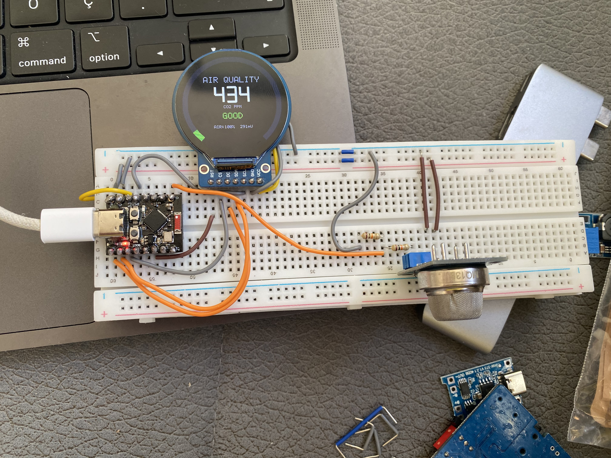
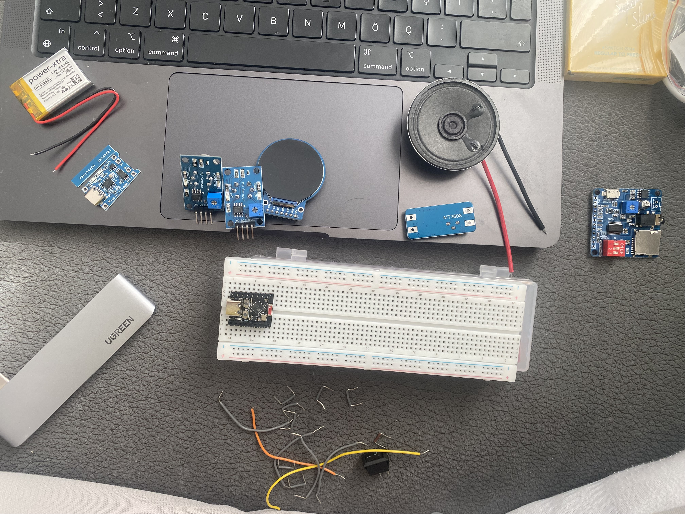

# ESP32-C3 Home CO₂ & Air Quality Monitor (Native C++)

A compact, native **C++ (ESP-IDF v5.4)** indoor air quality and CO₂-equivalent monitor built on the **ESP32-C3 SuperMini**, featuring a custom zero-dependency driver for the **1.28" GC9A01 (240×240) Round IPS TFT**, calibrated **MQ-135** analog gas sensing, interactive HTML breadboard wiring guides, and optional **DY-SV5W MP3** background audio feedback.



---

## Features

- **100% Native C++ (ESP-IDF):** Built directly on Espressif's official IoT Development Framework (`esp_driver_spi`, `esp_adc`, `esp_driver_uart`) with zero Arduino or third-party graphics library dependencies.
- **Smooth Round Gauge UI (`GC9A01` 240×240 IPS):**
  - Scanline-rasterized, gap-free 280° circular progress ring (`GOOD` green, `MODERATE` yellow, `POOR` orange, `HAZARD!` red).
  - High-resolution rounded 7-segment numeric display for live **CO₂ PPM** and **Air Quality % (`0–100%`)**.
- **Calibrated MQ-135 Sensing:**
  - Hardware factory ADC curve-fitting calibration (`esp_adc/adc_cali.h`) with 16-sample oversampling and Exponential Moving Average (`EMA`) filtering.
  - Automatic clean-air baseline (`R0` → `~420 ppm`) calibration after initial heater warm-up.
- **Interactive HTML Breadboard Diagrams:**
  - [docs/circuit-diagram.html](docs/circuit-diagram.html) — Phase 1 wiring guide (ESP32-C3 + GC9A01 + MQ-135 + 10kΩ voltage divider) with zoomed-in pin views and persistent wiring checklist.
  - [docs/circuit-diagram-speaker.html](docs/circuit-diagram-speaker.html) — Phase 2 wiring guide adding the **DY-SV5W MP3 module** and **8Ω speaker** to loop background tracks per air quality tier.

---

## Hardware Components



| Component | Model | Purpose |
| :--- | :--- | :--- |
| **Microcontroller** | **ESP32-C3 SuperMini** (RISC-V 160 MHz, 4 MB Flash) | Main controller, SPI display driver & ADC sampling |
| **Round Display** | **1.28" GC9A01 IPS TFT** (240×240, SPI) | Live circular CO₂ PPM & Air Quality % gauge |
| **Air Quality Sensor** | **MQ-135 Breakout Module** | Measures NH₃, VOCs, smoke & CO₂-equivalent |
| **Voltage Divider** | **2× 10kΩ Resistors** (`R1`, `R2`) | Safely steps down 5V `AO` sensor output by 2× (`0–2.5V`) for the 3.3V ESP32-C3 ADC |
| **Audio Module** *(Phase 2)* | **DY-SV5W** + **8Ω Speaker** | Plays background MP3 tracks (`00001.mp3`–`00004.mp3`) via UART based on air quality status |

---

## Pinout & Wiring

Open [docs/circuit-diagram.html](docs/circuit-diagram.html) (or [docs/circuit-diagram-speaker.html](docs/circuit-diagram-speaker.html)) directly in your browser for an interactive, hole-by-hole 830-point breadboard guide.

| Module | Module Pin | ESP32-C3 SuperMini Pin | Notes |
| :--- | :--- | :--- | :--- |
| **GC9A01 Round LCD** | `VCC` | `3.3V` | 3.3V logic & backlight power |
| | `GND` | `GND` | Common ground |
| | `SCL` | `GPIO4` (`IO4`) | SPI Clock (40 MHz) |
| | `SDA` | `GPIO6` (`IO6`) | SPI MOSI |
| | `CS` | `GPIO7` (`IO7`) | SPI Chip Select |
| | `DC` | `GPIO5` (`IO5`) | Data / Command control |
| | `RST` | `GPIO10` (`IO10`) | Hardware reset |
| **MQ-135 Sensor** | `VCC` | `5V` | 5V required for internal heater coil |
| | `GND` | `GND` | Common ground |
| | `AO` | `GPIO0` (`IO0` / `ADC1_CH0`) | Routed through `10kΩ + 10kΩ` voltage divider to `GND` |
| **DY-SV5W Audio** *(Optional)* | `5V` / `GND` | `5V` / `GND` | Set DIP switches to `1=OFF, 2=OFF, 3=ON` (UART mode) |
| | `IO1 / RXD` | `GPIO3` (`IO3`) | 9600 baud UART TX commands |

---

## Project Structure

```text
air-quality/
├── CMakeLists.txt                     # Top-level ESP-IDF CMake project
├── sdkconfig.defaults                 # ESP32-C3 target, 4MB flash & USB-Serial/JTAG console config
├── docs/
│   ├── circuit-diagram.html           # Interactive Phase 1 breadboard & zoomed resistor diagram
│   ├── circuit-diagram-speaker.html   # Interactive Phase 2 diagram with DY-SV5W MP3 & speaker
│   └── images/                        # Prototype build & hardware photos
└── main/
    ├── CMakeLists.txt                 # Component registration
    ├── main.cpp                       # Application loop, warm-up calibration & UI rendering
    ├── gc9a01.hpp / gc9a01.cpp        # Native C++ SPI driver, scanline gauge ring & 7-seg digits
    ├── mq_sensor.hpp / mq_sensor.cpp  # ADC oneshot driver, curve calibration & CO2/AQI math
    └── dy_sv5w.hpp / dy_sv5w.cpp      # UART driver for DY-SV5W MP3 voice playback module
```

---

## Build & Flash (ESP-IDF v5.4+)

1. **Activate your ESP-IDF environment:**
   ```zsh
   source ~/esp/esp-idf/export.sh
   ```

2. **Configure target and build:**
   ```zsh
   idf.py set-target esp32c3
   idf.py build
   ```

3. **Flash and open serial monitor over USB-C:**
   ```zsh
   idf.py -p /dev/cu.usbmodem* flash monitor
   ```
